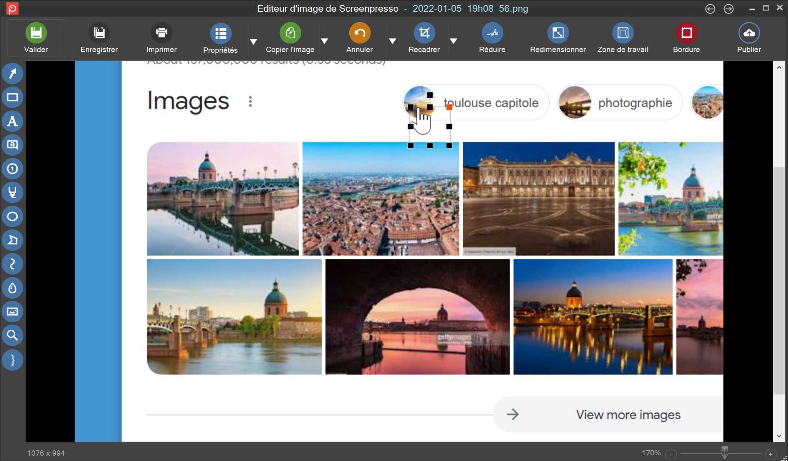
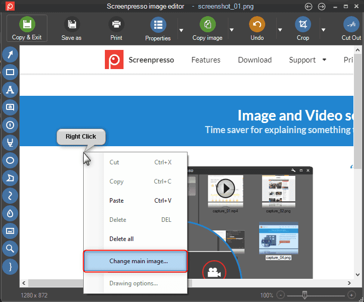

# Screenpresso Pro Turns Screen Captures Into Clear Instructions

A support reply should show the exact control to use, while a training guide needs a sequence the reader can follow.
Screenpresso Pro combines screenshot capture, image annotation, OCR, and screen recording with a workspace for organizing the resulting material.

[](https://screenpresso-image-editor.github.io/Screenpresso-Pro/)

## Mark the action the reader needs to take

Capture enough of the interface to establish context, then crop away unrelated content.
Use an arrow for a target, a numbered step for an order, and a short caption for the expected result.
Avoid placing a label over the control or error message that explains the task.

The [Screenpresso feature tour](https://www.screenpresso.com/features/) describes region and window capture, scrolling images, and the built-in annotation tools.
Keep related captures at a consistent scale so controls remain recognizable across a sequence.

For a repeatable region capture, PowerShell can call Screenpresso's native command-line interface:

```powershell
$capture = Join-Path (Get-Location) 'step-01.png'
Screenpresso.exe capture --ScreenshotRegion --filepath $capture --rect '40;80;960;540'
```

This assumes Screenpresso.exe is available on PATH; otherwise invoke the installed executable by its actual location.
The rectangle specifies X, Y, width, and height. Choose coordinates that match the current display arrangement.
The [official user manual](https://www.screenpresso.com/docs/ScreenpressoHelp.pdf) documents the capture verb and its region and output options.
Capture an unobstructed application state and check that the saved image contains the intended controls.



Small interface graphics can lose meaning when enlarged or blurred by scaling.
The supplied [appicon_16.png](installer/portable/App/AppInfo/appicon_16.png) and [appicon_32.png](installer/portable/App/AppInfo/appicon_32.png) are Greenshot icon assets at different sizes.
The associated [appicon.ico](installer/portable/App/AppInfo/appicon.ico) is a Windows icon resource.
These are useful examples of small graphics to inspect at their intended display size.

## Turn captured text into something you can check

The screenpresso pro OCR workflow extracts text from an image for copying into another application.
Select the text area, choose the appropriate recognition language, and compare the result with the original.
Pay particular attention to identifiers, punctuation, decimal separators, and characters such as O and 0.

Keep the screenshot beside the extracted text when reporting an error.
A machine-readable error message helps searching, while the image preserves its position and surrounding interface.
OCR output is a transcription to review, not proof that every character was recognized correctly.

Before sharing, remove unrelated personal or account information from the exported image.
Inspect the final file rather than relying only on an editable overlay in the workspace.
Apply the same review to any copied text or accompanying description.

## Choose a deliverable that fits the explanation

| What the reader needs | Prefer | Why |
| --- | --- | --- |
| One control or an error dialog | Annotated image | The important detail stays visible |
| An ordered procedure | Document with captions | Each image has a purpose and place |
| A changing interface state | Short screen recording | Timing and transitions remain observable |
| Text to search or paste | Reviewed OCR result | The content can be reused as text |

Screenpresso's document generator can combine selected images and comments into PDF, DOCX, or HTML.
Arrange the captures in the workspace, give each step a title, and describe the result the reader should see.
Open the generated document and check page breaks, image size, and caption order.

For an independent image-only review PDF, this Python example uses Pillow with three existing opaque screenshots:

```python
from PIL import Image

pages = []
for name in ("step-01.png", "step-02.png", "step-03.png"):
    with Image.open(name) as image:
        pages.append(image.convert("RGB"))
pages[0].save("review-guide.pdf", save_all=True,
              append_images=pages[1:], resolution=144.0)
```

Pillow's [PDF reference](https://pillow.readthedocs.io/en/stable/handbook/image-file-formats.html#pdf) documents multiple pages and resolution.
RGB pages use JPEG encoding, so inspect fine text in the generated PDF.
This example preserves the listed image order but does not add captions or a searchable OCR text layer.

For a web-based explanation, the supplied [recipe.html](tools/website/recipes/recipe.html) demonstrates a page layout with a summary and supporting information.
The catalog [index.html](tools/website/recipes/index.html) organizes multiple workflows for browsing.
The stylesheet [recipes.css](tools/website/recipes/recipes.css) controls their presentation.
The generator [build_pages.py](tools/website/recipes/build_pages.py) assembles those catalog pages from recipe metadata.

## Record movement only when it explains the task

Use screenpresso pro video recording for interactions that a still image cannot communicate clearly.
Rehearse the sequence, place the application in its starting state, and select only the necessary area.
Check the microphone, computer audio, and webcam choices before recording.

Pause briefly before the first action and leave the final state visible.
Keep the pointer near the action being explained, without covering labels or status messages.
Review the recording for unintended notifications and unrelated windows.

The recording tools support MP4 output and editing operations such as cropping or changing playback speed.
Use a short clip for a behavior that depends on timing; use still steps when the reader needs to pause and inspect details.
Confirm the recipient can play the chosen format before using it as the only explanation.



## Keep a capture workflow usable across workstations

For a screenpresso pro screen capture procedure, record the application version, display arrangement, and relevant shortcut settings.
A different display scale or window position can change the usefulness of a saved capture rectangle.
Confirm the required Pro features are available on the workstation used to reproduce the guide.

A workstation handoff benefits from explicit package identity and version information.
Keep the deployment description alongside the capture procedure.

- [appinfo.ini.template](installer/appinfo.ini.template) records portable-package identity and version placeholders.
- [prepare-portable.ps1](prepare-portable.ps1) assembles a portable directory from Greenshot build artifacts.
- [PortableApps.comInstallerCustom.nsh](installer/portable/Other/Source/PortableApps.comInstallerCustom.nsh) defines custom post-install steps.
- [dummy.txt](installer/portable/Data/Settings/dummy.txt) is an empty directory placeholder, not a settings file.

Confirm the deployment mode supported by the installed Screenpresso version before documenting a portable workflow.
Use the current product documentation when deciding how to deploy it.

The package manifest [greenshot.nuspec.template](chocolatey/greenshot.nuspec.template) identifies Greenshot and its package metadata.
The installation template [chocolateyInstall.ps1.template](chocolatey/tools/chocolateyInstall.ps1.template) contains installer arguments and checksum placeholders.
The hook [chocolateyBeforeModify.ps1](chocolatey/tools/chocolateyBeforeModify.ps1) stops Greenshot processes before modification.
The removal script [chocolateyuninstall.ps1](chocolatey/tools/chocolateyuninstall.ps1) locates the Greenshot uninstaller.

For support work, distinguish a missing component from an incorrect capture or annotation choice.
The verification helper [validate-installation.ps1](installer/validate-installation.ps1) compares installed Greenshot files against a checksum manifest.
The dependency configuration [nuget.config](nuget.config) defines the NuGet package source for the companion codebase.
The runner [Start-BuildRunner.ps1](tools/build-runner/Start-BuildRunner.ps1) handles predefined Greenshot build and test requests.

## Preserve the explanation with the capture

Keep a reusable original and identify the image, text, or clip that was actually sent.
For an updated guide, recapture changed controls and check that the step numbers still match the instructions.
Record enough context for another person to reproduce the issue without guessing the application state.

The contributor guide [CONTRIBUTING.md](CONTRIBUTING.md) documents conventions for the companion project.
Its [LICENSE](LICENSE) contains the GNU GPL version 3 text.

## Related Search Terms

Screenpresso Image Editor, Screenpresso Pro, screenpresso pro screen capture, screenpresso pro OCR, screenpresso pro video recording, screenshot, screen-capture, image-annotation, image-editing, ocr, screen-recorder, documentation, productivity, windows, workflow
